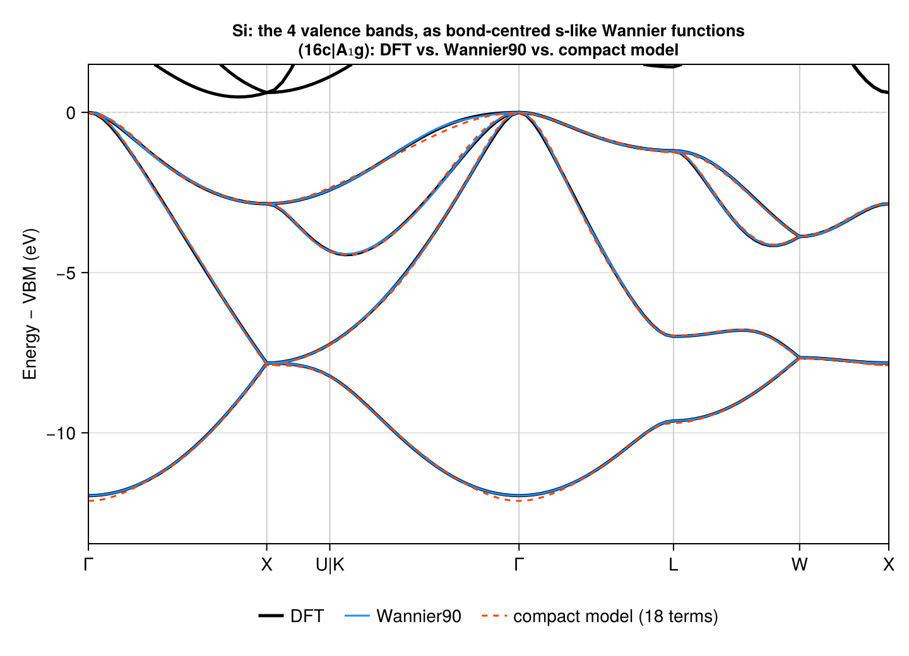
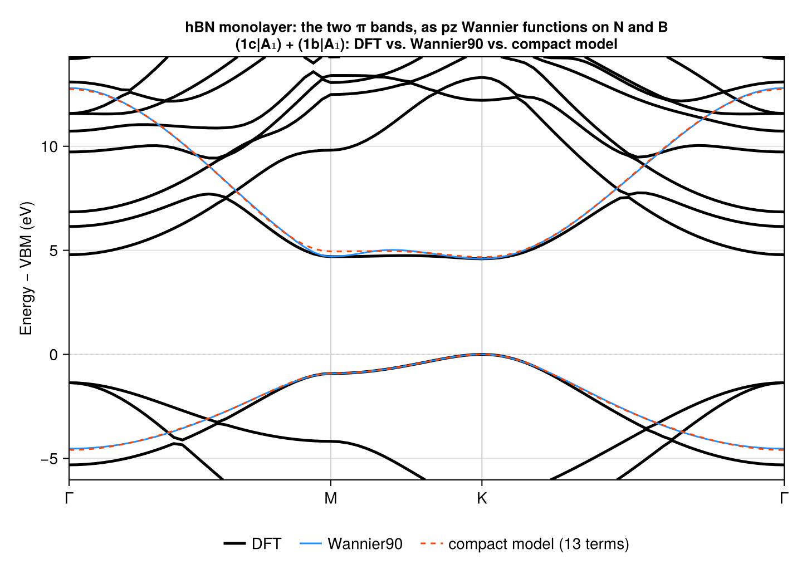
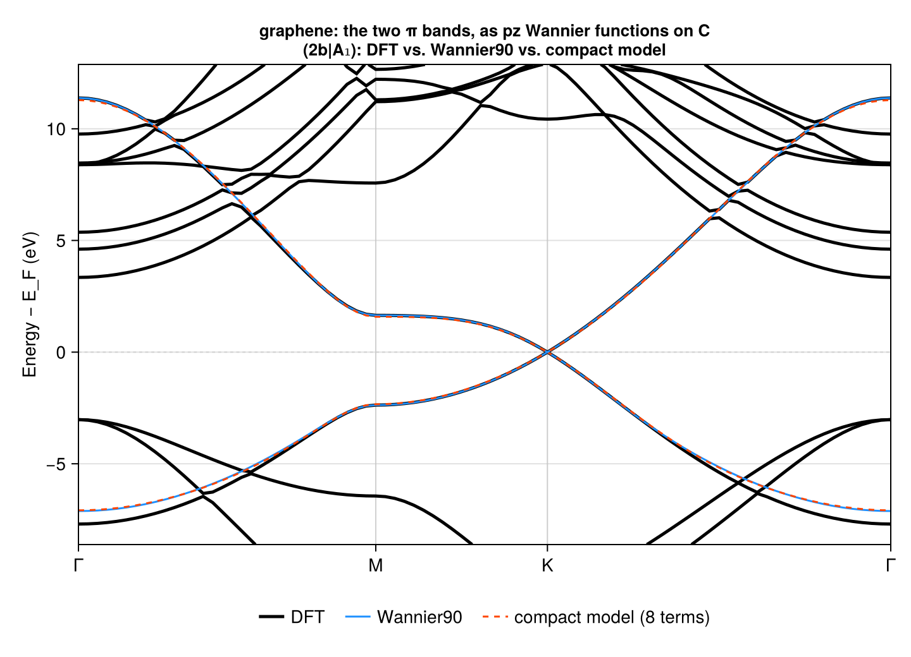
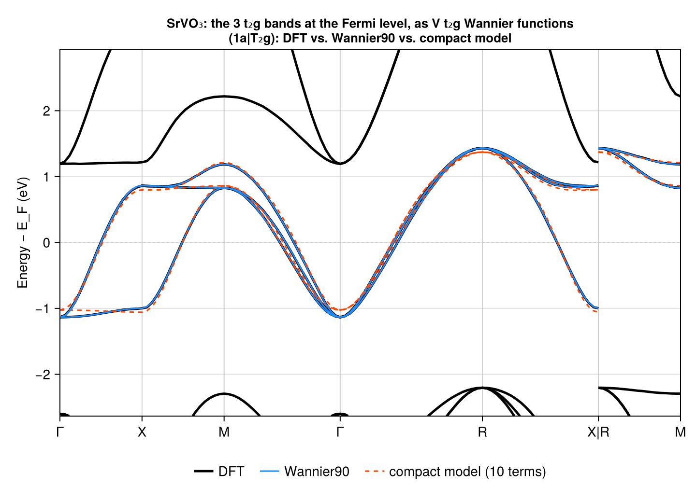

# From DFT + Wannier90 to a symmetric tight-binding model

Proof of concept: map the Wannier Hamiltonian of a DFT calculation, i.e., Wannier90's
`_hr.dat` file, onto a symmetry-constrained `ParameterizedTightBindingModel`. That is, find
the coefficients `cs` of `tbm = tb_hamiltonian(cbr, Rs)` that reproduce the Wannier
Hamiltonian, then extract a *compact* model with as few terms as a target accuracy allows.

Everything here runs on a laptop in Julia: DFT via [DFTK.jl](https://dftk.org), and
Wannierization via [Wannier90](https://wannier.org) through DFTK's interface (the Wannier90
binary comes from `wannier90_jll`, i.e., no manual install).

## Cases

| case | material | bands | EBR(s) | Wannier functions |
|------|----------|-------|--------|-------------------|
| `si-valence` | Si (Fd-3m, 227) | 4 valence bands (isolated) | (16c\|A₁g) | bond-centred s-like; maximally localized |
| `hbn-pz` | hBN monolayer (plane group p3m1, 14) | 2 π bands (entangled in energy) | (1c\|A₁) + (1b\|A₁) | p_z on N and B; disentangled, maximally localized |
| `graphene-pz` | graphene (plane group p6mm, 17) | 2 π bands (entangled in energy) | (2b\|A₁) | p_z on C; disentangled, maximally localized |
| `srvo3-t2g` | SrVO₃ (Pm-3m, 221) | 3 t₂g bands at E_F (overlapping e_g in energy) | (1a\|T₂g) | V t₂g (d_yz, d_xz, d_xy); disentangled, maximally localized |

**Results in brief.** For each case, the Wannier Hamiltonian is symmetric to machine
precision in the EBRs' orbital basis. The symmetric model over all of its translations
reproduces it exactly: `ptbm(k)` = Wannier90's `H(k)` to ~1e-14 eV. Compact models, with
the fewest (strongest) hopping orbits for 50 meV RMS agreement with Wannier90:

| case | full model (terms) | compact model (terms) | compact vs. DFT (RMS) |
|------|------:|------:|------:|
| `srvo3-t2g` | 125 | 10 (6 terms: 79 meV) | 46 meV (frozen window) |
| `hbn-pz`    | 81  | 13 (6 terms: 0.18 eV) | 72 meV (frozen window) |
| `graphene-pz` | 60 | 8 (7 terms: 69 meV) | 34 meV (frozen window) |
| `si-valence`| 230 | 18 (12 terms: 78 meV) | 50 meV |

## Pipeline

| step | script | environment | does |
|------|--------|-------------|------|
| 1 | `01_setup.jl [case]` | `.` (STB) | crystal structure & EBRs → `out/<case>/setup.toml` |
| 2 | `dft/02_dft_wannier.jl [case]` | `dft/` (DFTK) | SCF, DFT bands, Wannier90 → `out/<case>/{bands_dft.*, wannier/}` |
| 3 | `03_fit.jl [case] [tol]` | `.` (STB) | read `_hr.dat`, fit, extract a compact model, compare bands → `out/<case>/{bands.png, fit.toml}` |

```sh
cd examples/dft-wannier90
julia --project=. -e 'using Pkg; Pkg.instantiate()'
julia --project=dft -e 'using Pkg; Pkg.instantiate()'
julia --project=. 01_setup.jl srvo3-t2g
julia --project=dft -t 4 dft/02_dft_wannier.jl srvo3-t2g   # ~8 min (si-valence: ~2 min; hbn-pz, graphene-pz: ~3 min)
julia --project=. 03_fit.jl srvo3-t2g 0.05
```

Cases are defined in `common.jl` (`CASES`).

**Why two environments?** DFTK 0.8 requires Optim 1.x, while SymmetricTightBinding's Optim
extension requires Optim 2.x, so the two cannot share an environment. This is no real
restriction: the steps communicate only via files (`setup.toml` one way; Wannier90 files
and DFT bands the other).

## Choices, and why

- **Setting.** Lattice and atom positions come from Crystalline (step 1): the primitive
  basis `primitivize(directbasis(sgnum), centering)`, and the sites of the atoms' Wyckoff
  positions in that basis. So DFT, Wannier90 (the lattice translations `R` in `_hr.dat`),
  and SymmetricTightBinding all use the same basis; no conversion is needed.
- **2D (hBN, graphene).** The DFT is 3D: the plane-group lattice is embedded with a
  perpendicular third lattice vector (12 Å of vacuum), with all atoms in the plane z = 0.
  The model is 2D (plane groups p3m1 and p6mm). This works because both are strictly
  planar: every in-plane symmetry operation is a symmetry of the 3D structure. The
  out-of-plane mirror is not part of the plane group, but it separates the p_z (odd) from
  the σ (even) states. With a k-grid of n×n×1, all Wannier90 translations lie in the plane.
- **DFT.** LDA; PseudoDojo norm-conserving pseudopotentials (via PseudoPotentialData.jl);
  plane-wave cutoffs below the recommended ones for converged total energies (16 Ha for Si,
  30 Ha otherwise), which is fine for band structures at this level. Gaussian smearing for
  the metal SrVO₃ and the semimetal graphene. Energies are relative to the VBM
  (insulators) or the Fermi level.
  A DFTK gotcha: identical atoms must share one `ElementPsp` object. Otherwise, spglib
  treats them as distinct species and finds too few symmetries; a first SrVO₃ run found
  Pmmm instead of Pm-3m. Results are unaffected, but the SCF is slower (fewer symmetries
  to reduce the k-points by) and the automatic k-path is wrong.
- **Initial projections** are generated from the EBRs (step 1): one per tight-binding
  orbital, centred at its Wyckoff position (`orbital_positions(cbr)`), and *listed in
  SymmetricTightBinding's orbital order*, so the Wannier functions come out in the model's
  orbital order. The angular parts are real harmonics, chosen per site irrep (`angular` in
  `CASES`): s for (16c|A₁g); p_z for hBN's (1c|A₁) and (1b|A₁) and graphene's
  (2b|A₁), since p_z is invariant under the in-plane operations; d_yz, d_xz, d_xy for
  (1a|T₂g).
- **Windows.**
  - Isolated bands (`si-valence`) are specified by band index (`bands`); the outer and
    frozen windows are placed automatically in the gaps around them, if needed.
  - SrVO₃'s t₂g bands (bands 21–23, from E_F − 1.14 to E_F + 1.43 eV) are separated from
    the O 2p bands below, but overlap in energy with the e_g bands above, whose bottom is at
    E_F + 1.19 eV. Wannier90 selects states by energy only (DFTK's interface has no
    `exclude_bands`), so they need disentanglement: an outer window of E_F − 1.6 to
    E_F + 3 eV, and a frozen window of E_F − 1.6 to E_F + 1.15 eV, containing only t₂g
    states.
  - hBN's π bands overlap in energy with σ bands, so they need disentanglement. The frozen
    window, VBM − 1 eV to VBM + 4.7 eV, contains only π and π* states near K and M (chosen
    from a bands-only run: `dft_bands.log`). The odd p_z projections exclude the even σ
    states.
  - Likewise for graphene: the frozen window, E_F − 2.9 eV to E_F + 3 eV, lies between
    the top of the σ bands (E_F − 3.02 eV) and the lowest non-π unoccupied state
    (E_F + 3.35 eV), both at Γ.
- **Wannier90 settings.** Maximal localization (`num_iter = 1000`).
  `use_ws_distance = true` (Wannier90's default): each hopping is placed at its
  minimal-image lattice translation, recorded in `_wsvec.dat`. `read_wannier90` reads it if
  present. This matters for symmetry: otherwise, hoppings at the edge of the Wigner–Seitz
  supercell are split over images in a symmetry-breaking way.

## The STB side

New on branch `wannier90-import`, both unexported for now:
- `read_wannier90(prefix, positions) → Wannier90TightBindingModel`. It reads
  `<prefix>_hr.dat`, divides by the Wigner–Seitz degeneracy weights, and applies the
  minimal-image shifts of `<prefix>_wsvec.dat` if present. This reproduces Wannier90's own
  interpolated bands (`_band.dat`) to its print precision (~1e-5 eV).
- `fit_wannier90(tbm, w90tbm) → ptbm`, a linear least-squares fit in real space.
  - Each matrix element `H_ij(R)` is a hopping along δ = rᵢ − rⱼ − R, so it belongs to
    exactly one hopping orbit of `tbm`. The fit therefore decouples into one small problem
    per orbit.
  - For an orbit {δₙ} with terms `t`, the Wannier90 amplitudes `H_ij(rᵢ − rⱼ − δₙ)` are
    read into the orbit's own layout `[n, i, j]`. They are then fitted by
    `∑_t c_t MmtC_t[n, i, j]` over real `c_t`, i.e., orthogonally projected onto the
    symmetry-allowed amplitudes.
  - The coefficients are real because STB's terms span the allowed Hamiltonians as a real
    vector space: hermiticity and time reversal involve complex conjugation.

**Compact models (step 3).**
- First, the full model, over all translations of the Wannier Hamiltonian, is fitted;
  this is exact if the Wannier Hamiltonian is symmetric.
- Then its hopping orbits are ranked by the norm of their amplitudes. The fewest,
  strongest orbits whose bands match the Wannier90 bands within `tol` (RMS along the
  k-path; default 50 meV) form the compact model: an ordinary `TightBindingModel`,
  `tbm[keep]`.
- Truncating the exact real-space fit is optimal in real space. It is not necessarily
  optimal for the band energies: refitting the compact model to the DFT bands (e.g., with
  STB's `fit`, started from these `cs`) could absorb the dropped hoppings into effective
  ones.

**Basis alignment (`common.jl`).** Matching orbital order and centres is not enough when
the site irreps are multi-dimensional, as for (1a|T₂g).
- The Wannier functions are real harmonics, whereas STB's orbitals are whatever basis
  Crystalline's site irrep uses at the first site, carried to the other sites by coset
  representatives.
- The two bases are related by a site-local unitary `U` (|stbₐ⟩ = ∑_b |w90_b⟩ U[b,a]) that
  intertwines the two representations of the space group: `ρ_w90(g) U = U ρ_stb(g)`.
  - `ρ_w90` is built from the rotation matrices of the real harmonics, which are computed
    numerically for l ≤ 2.
  - `ρ_stb` is `site_induced_sgrep_excl_phase(cbr, g)`.
- By Schur's lemma, `U` is unique up to a phase per site irrep. It is computed as the null
  space of the stacked linear equations, made unitary by a polar decomposition, and then
  applied as `H_stb(R) = U' H_w90(R) U`.
- For (1a|T₂g), `U` is a permutation: STB's partner functions are (d_xy, d_yz, d_xz).
- In an earlier s+p model of Si's 8 lowest bands, (8a|A₁) + (8a|T₂), `U` was a signed
  permutation that differed between the two Si sites. Without it, the symmetric fit left a
  ~70% residual.

## Results

### `si-valence`: Si valence bands, (16c|A₁g)

Wannier90: four maximally localized bond orbitals, centred exactly at the bond midpoints,
each with spread 2.067 Ų. The full model (809 translations; 230 terms in 178 orbits) fits
every orbit to ~5e-15 eV, and reproduces Wannier90's bands to 2e-14 eV. Wannier90 vs. DFT:
13 meV RMS (interpolation from an 8×8×8 grid).

| orbits | terms | RMS / max vs. Wannier90 (eV) |
|-------:|------:|-----------------------------|
| 2  | 2  | 1.195 / 2.60 |
| 5  | 6  | 0.249 / 0.62 |
| 8  | 10 | 0.115 / 0.32 |
| 10 | 12 | 0.078 / 0.24 |
| 13 | 18 | 0.049 / 0.18 |



Compact models need ~10–20 terms for ~50–100 meV accuracy. Several of the strongest orbits
are long-range and collinear: δ = (½,0,0), (1,0,0), …, (7/2,0,0) in the primitive basis,
i.e., hoppings along straight chains of bond centres (up to 13.4 Å). Si's 12 eV-wide
valence band is fairly free-electron-like, and in the cubic group a weak hopping is
amplified by its many symmetry-equivalent partners.

### `hbn-pz`: hBN π bands, (1c|A₁) + (1b|A₁)

Wannier90: p_z Wannier functions centred exactly on N and B, with spreads 0.72 Ų (N) and
1.07 Ų (B). The full model (173 translations; 81 terms in 81 orbits) fits every orbit to
~3e-15 eV, and reproduces Wannier90's bands to 1e-14 eV. Wannier90 vs. DFT, in the frozen
window: 17 meV RMS.

| orbits | terms | RMS / max vs. Wannier90 (eV) |
|-------:|------:|-----------------------------|
| 2  | 2  | 0.930 / 2.07 |
| 6  | 6  | 0.176 / 0.61 |
| 10 | 10 | 0.074 / 0.30 |
| 13 | 13 | 0.050 / 0.25 |



- The leading terms are those of the familiar two-band model: on-site energies 0.53 eV (N)
  and 4.84 eV (B), relative to the VBM; nearest-neighbour hopping −2.65 eV; and
  second-neighbour hoppings 0.26 eV (N–N) and 0.18 eV (B–B).
- The Wannier bands deviate from DFT near Γ (e.g., by ~0.7 eV at the bottom of the π
  band). There, disentanglement mixes the π states with other mirror-odd states:
  nearly-free-electron states that are low in energy in a slab with vacuum. An energy
  window cannot freeze the π states at Γ, since σ bands lie between them and the
  frozen window. Projectability-based freezing (`dis_froz_proj` in newer Wannier90s, or
  Wannier.jl) is the standard remedy; `wannier90_jll` ships 3.1.
- Within the frozen window (near K and M, i.e., around the gap), the compact model
  matches DFT to 72 meV RMS.

### `graphene-pz`: graphene π bands, (2b|A₁)

Wannier90: p_z Wannier functions centred exactly on the two C sites, each with spread
0.92 Ų. The full model (173 translations; 60 terms in 60 orbits) fits every orbit to
~5e-15 eV, and reproduces Wannier90's bands to 2e-14 eV. Wannier90 vs. DFT, in the frozen
window: 3 meV RMS.

| orbits | terms | RMS / max vs. Wannier90 (eV) |
|-------:|------:|-----------------------------|
| 1 | 1 | 1.162 / 2.81 |
| 4 | 4 | 0.203 / 0.42 |
| 5 | 5 | 0.112 / 0.25 |
| 7 | 7 | 0.069 / 0.18 |
| 8 | 8 | 0.036 / 0.10 |



- The leading terms: on-site energy 0.389 eV (relative to E_F); nearest-neighbour hopping
  −2.857 eV (1.42 Å); second- and third-neighbour hoppings 0.257 eV (2.46 Å) and
  −0.250 eV (2.84 Å). The third-neighbour hopping is as strong as the second, as in
  Jung & MacDonald's Wannier-function model of graphene's π bands
  ([PRB 87, 195450 (2013)](https://doi.org/10.1103/PhysRevB.87.195450)), so a t–t′ model
  is not a good truncation. The remaining four terms are 24–52 meV, up to 5.7 Å.
- The Dirac point at K is symmetry-enforced for (2b|A₁) (a two-dimensional irrep at K),
  so every compact model keeps it; truncation only shifts its energy and velocity (the
  8-term model has it at E_F + 3 meV).
- As for hBN, the Wannier bands deviate from DFT at the bottom of the π band at Γ (by
  ~0.6 eV), where the π states cannot be frozen.

### `srvo3-t2g`: SrVO₃ t₂g bands, (1a|T₂g)

Wannier90: three t₂g Wannier functions centred exactly on V, each with spread 1.96 Ų.
The full model (729 translations; 125 terms in 35 orbits) fits every orbit to ~1e-15 eV,
and reproduces Wannier90's bands to 6e-15 eV. Wannier90 vs. DFT, in the frozen window:
3 meV RMS. Basis alignment: STB's (1a|T₂g) partner functions are (d_xy, d_yz, d_xz).

| orbits | terms | RMS / max vs. Wannier90 (eV) |
|-------:|------:|-----------------------------|
| 1 | 2  | 0.485 / 0.92 |
| 2 | 3  | 0.265 / 0.48 |
| 3 | 6  | 0.079 / 0.18 |
| 4 | 10 | 0.049 / 0.11 |



The best showcase, with graphene: 6 terms (on-site, nearest and next-nearest neighbours)
give 79 meV RMS, and 10 terms give 49 meV.
- On-site energy: 0.478 eV (relative to E_F).
- Nearest neighbours (along ±x, ±y, ±z; 3.84 Å): two terms, −0.269 and −0.029 eV. These
  are the familiar dd-π-like hopping between two t₂g orbitals in the plane containing the
  bond, and the weak dd-δ-like one.
- Next-nearest neighbours (5.43 Å): three terms, led by −0.088 eV.

These are close to the t₂g hoppings commonly quoted for SrVO₃ (t ≈ −0.26 eV, t′ ≈ −0.08 eV).

## On determining the EBR decomposition

Here, the EBRs are chosen up front from chemistry: bond orbitals; p_z orbitals; t₂g
orbitals. They are then *validated* in three ways:
1. Wannier90 converges to well-localized Wannier functions with symmetric centres and
   spreads.
2. The Wannier Hamiltonian is symmetric under the full space group in the EBRs' orbital
   basis: the symmetric fit reproduces every hopping orbit to ~1e-15 (relative).
3. The resulting model reproduces the DFT bands.

A wrong choice should generally fail these checks: e.g., poorly localized Wannier
functions, or a large residual in the symmetric fit. The basis-alignment example above
shows how visible a mismatch between Wannier functions and the EBRs' orbitals is.

A more systematic route would be to:
- compute the irreps of the DFT Bloch states at the maximal k-points, e.g., with IrRep or
  irvsp (for VASP or Quantum ESPRESSO output), or directly from DFTK's wavefunctions via
  `DFTK.apply_symop` (care is needed with the phase conventions of nonsymmorphic
  operations; cf. the `[⚠️ phase]` notes in `symmetry_analysis.jl`);
- decompose the resulting symmetry vector into EBRs with Crystalline.

That decomposition need not be unique, and it fixes only the symmetry vector, not the
"real-space" BR. So step 1 still involves a choice among the candidates, which steps 2–3
then validate.

## Open questions / next steps

- **API.** Exports of `read_wannier90` and `fit_wannier90`. Should `fit_wannier90` also
  accept a `CompositeTightBindingModel`, or a `_hr.dat` prefix directly?
- **Basis alignment in STB?** It is general (only the real-harmonic representation of the
  projections is needed), and without it, multi-dimensional site irreps are unusable. It
  could become, e.g., an `orbitals = [(l, m), …]` keyword to `read_wannier90`. Currently
  l ≤ 2; spinful (spinor) projections would need the SU(2) part too.
- **Compact models.** Rank orbits by their effect on the bands rather than by norm?
  Refit the compact model to DFT band energies (STB's `fit`)?
- **Determining the EBRs from DFT** (see above).

## Files

- `common.jl`: case definitions, BR & site helpers, basis alignment.
- `out/<case>/setup.toml`: structure, DFT & Wannier90 parameters, projections (step 1).
- `out/<case>/dft.log`: DFTK output, incl. band ranges (step 2).
- `out/<case>/bands_dft.{dat,toml}`: DFT bands along DFTK's (Brillouin.jl) high-symmetry
  path, in the primitive reciprocal basis; energy zero & labels (step 2).
- `out/<case>/wannier/`: Wannier90 input & output (step 2). Only `.win`, `.wout`, and
  `_centres.xyz` are kept in git (`out/.gitignore`; e.g., `.mmn` can be tens of MB); rerun
  step 2 to regenerate the rest (`_hr.dat`, `_wsvec.dat`, ...).
- `out/<case>/fit.{log,toml}`, `bands.png`: step 3.
